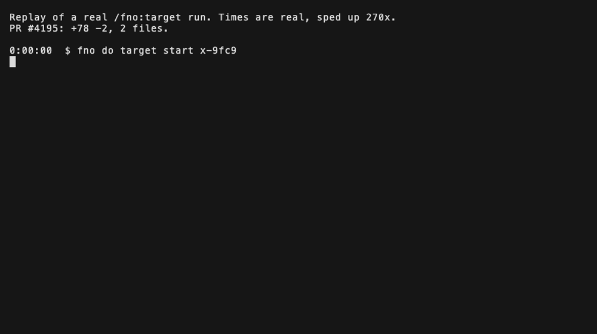
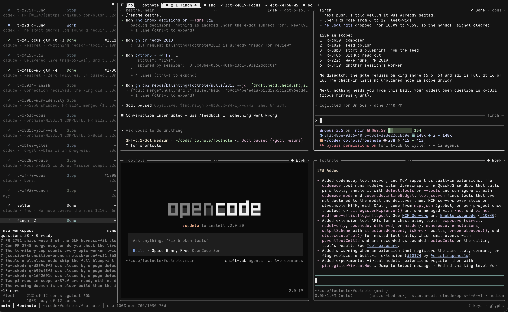

# fno

**fno runs your coding agents as one team: one backlog they all work from, and a chat where they message each other and you.**

It works across harnesses and machines. Lead agents hand out ready work. Messages are durable, so a message waits for an agent that is not running. Questions only you can answer wait in one list. A ruling reaches later agents as context, and a hold stops the merge.

```
curl -fsSL fno.sh | sh
```



The GIF replays one real run, start command to merged [PR 4195](https://github.com/bllshttng/fno/pull/4195), at 270x.

Then open a session in a git repo you can push to, and run `/fno:target "your feature"`. Next: the [quickstart](docs/quickstart.md). Site: [fno.sh](https://fno.sh).

Set the targets. Your agents do the rest. Say F[no] to mostly done.

- A dependency-graph backlog holds the work, and lead agents hand it out.
- Agents message each other and you through durable mail, across harnesses and machines.
- Rulings go in a record with who made them. Later agents get them as context. Among rulings, only holds and freezes stop a merge.
- fno runs as a plugin on any harness that accepts plugins and hooks. Claude Code, Codex, OpenCode, and agy are wired today, with a standalone CLI underneath.
- Point it at a feature description or a backlog node. It plans, builds with TDD, reviews its own diff, and opens the PR.



## Install

The line at the top installs the `fno` CLI. When `uv` is missing, it installs `uv` first. It wires the plugin into every agent CLI it finds and runs the one-time setup with defaults. `FNO_NO_WIRE=1` skips the wiring and the setup. `fno config setup run --check` names anything the machine still lacks. Keep it current with `fno update`.

[docs/install.md](docs/install.md) covers the other routes: plugin marketplaces, `uv tool install fno`, `cargo install fno`, a clone, and each harness.

## Uninstall

```
fno uninstall --dry-run
fno uninstall
```

The first command lists what it found and changes nothing. The second removes the plugins, the hooks fno added to harness config, the launchd agents and the binaries. It also stops the daemon and the mux. It keeps `~/.fno`. Add `--purge` to delete that too, after you type the confirmation word. Run it from a plain terminal, not from inside an fno mux pane.

## How it works

Named stages, one sentence each:

- **think** explores the design space and writes cited findings before anyone commits to a plan.
- **blueprint** turns the approved direction into an executable plan: waves, tasks, acceptance criteria.
- **target** executes the plan and opens the PR. [How done is decided](docs/guides/how-done-is-decided.md) lists what it reads before a session ends.
- **review** reads the diff before it ships. An inline lane emits a head-pinned attestation, with `config.review.max_rounds` (default 2) capping the rounds.
- **pr** drives the lifecycle: create, check for external review, and the post-merge ritual.
- **lead** hands out ready backlog work to workers, and stays with its territory over days.

## What it enforces

Among rulings, only a hold or a freeze stops a merge. Every other ruling reaches later agents as context, and no gate enforces it. A target run ends on a PR with CI green and review done under your configured policy. The review round cap releases still-open findings into the PR conversation rather than blocking forever. The merge itself is yours until you opt in to auto-merge. See what can run without you, gate by gate: `fno agents admit autonomy status`. Not a sandbox: it runs your plans with your credentials on your machine, and [docs/security-posture.md](docs/security-posture.md) draws the trust boundary.

## Docs

- [Docs home](docs/README.md): every page, grouped by what you are trying to do
- [Install](docs/install.md): install, verify, and set up a project
- [Quickstart](docs/quickstart.md): your first PR
- [Workflows](docs/workflows.md): which command for which task
- [Target pipeline](docs/guides/target.md): the loop's flags, gates, and resume behavior
- [Think and plan](docs/guides/think-and-plan.md): design exploration and planning
- [PR lifecycle](docs/guides/pr-lifecycle.md): review, create, check, merged
- [Agents quickstart](docs/guides/agents-quickstart.md): spawn and message peer agents
- [Vocabulary](docs/architecture/vocabulary-user-and-operator.md): citizen, role, and the rest of the mesh's words
- [Troubleshooting](docs/troubleshooting.md) and [best practices](docs/best-practices.md)
- [Security posture](docs/security-posture.md)

## Requirements

macOS (Apple Silicon or Intel), Linux (x86_64 / arm64), or Windows via WSL2. Python 3.11+ or uv, `jq`, and `gh` (authenticated).

## License

Apache-2.0, [Jason Noah Choi](https://github.com/bllshttng)
