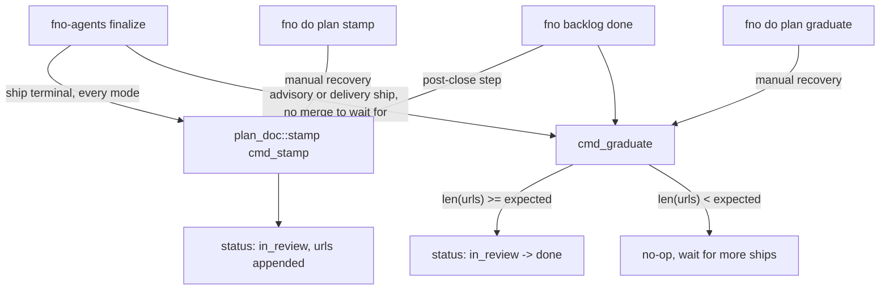

# Plan Completion Stamp

## Is this page for you?

You want to know from the plan file alone whether a plan shipped, where the PR lives, and which sessions ran it. This page owns the frontmatter stamp. Misreading it sends you into `ledger.json` and `git log` for an answer the plan already carries.

Not for: how completion is decided from the world (PR + CI + review). That is [control-plane-loop.md](control-plane-loop.md).

## Overview

The plan completion stamp makes shipped plans self-describing. When a `/target` run ships, it writes structured metadata directly into the plan's YAML frontmatter. A reviewer browsing the plans folder sees at a glance whether a plan shipped, the ship time, and the PR link. No look at `ledger.json`, `git log`, or any external registry is needed.

Before this feature, a plan file looked identical whether it had been shipped
last week or was still sitting in the backlog. The only way to answer "did
this ship?" was to cross-reference `~/.fno/ledger.json` by `plan_path`
or grep git history for a PR that touched the same files. Both paths required
context outside the plan itself and were invisible to Obsidian-based browsing.

## Schema

The stamp lives in the plan's YAML frontmatter. For folder plans the target
file is `00-INDEX.md`; for single-file quick plans it is the plan file itself.

```yaml
---
status: in_review       # or "done" after graduation
shipped_at: 2026-04-22T14:31:05Z
urls: [https://github.com/org/repo/pull/42]
session_ids: [abc123]
expected_url_count: 1   # cross-project plans set this to the project count
---
```

The codec is `crates/fno-agents/src/plan_doc/codec.rs`. It keeps every scalar as a string and keeps each list in the form it was read. An inline list (`key: [v1, v2]`) stays inline. A block list (`- item` lines) stays a block list on rewrite. A nested block it does not understand stays opaque and is written back byte for byte. Key order is preserved.

See `CLAUDE.md` under "Plan Completion Stamp" for the canonical field
definitions. This document goes deeper on the runtime behavior.

## `in_review` vs `done`

Two distinct terminal states exist because cross-project plans can ship their
PRs incrementally.

| Status | Meaning |
|--------|---------|
| `in_review` | At least one PR URL is stamped; may still await more URLs |
| `done` | All expected URLs are present (`len(urls) >= expected_url_count`) |

For single-project plans, `expected_url_count` is 1. The first stamp sets `status: in_review`. A code plan flips to `done` at the merge of its PR. An advisory plan has no merge to wait for, so it flips at once.

For cross-project plans, each sub-repo's target session stamps its own URL.
The plan stays `in_review` until every repo has contributed a URL. The final
session's `graduate` call sees `len(urls) >= expected_url_count` and flips
to `done`. Between the first and last sub-repo ships, the plan is genuinely
`in_review` - real code is in review, just not everywhere yet.

## The promise gate (node closure)

A plan reaching `done` and a node closing are gated separately. The merge gate asks "is a PR merged" (a fact about an artifact). The promise gate asks "did the plan's declared work all ship". One verdict function, `resolve_promise_evidence`, is consulted by all three close verbs: `fno backlog done`, `fno backlog reconcile`, and the deprecated `done` spelling. A node can therefore never close through a second, ungated path.

The gate fires ONLY on an explicit declaration. A plan declaring **neither `close_probes` nor `expected_url_count`** closes exactly as it does today. `## Wave N` headings are internal structure, not a promise, so a multi-wave single-PR plan closes clean. One .md == one PR == one node is the house rule. Inferring "multi-wave" from headings was rejected because it false-positives on exactly that common case, parking every such node on autonomous `/target`. A gate that only fires on an explicit promise cannot false-positive. Two conditions, first refusal wins:

- **Outcome probes.** Any declared `close_probes` entry exits non-zero. Probes
  run via `fno-agents probe-run` (the same runner `loop-check` uses for
  `done_probes`).
- **Ship count.** A declared `expected_url_count: N` (N >= 2) and fewer than N
  of the node's PR refs are MERGED.

Coverage grows as `/blueprint` stamps `expected_url_count` going forward;
nothing retroactively parks. A refusal exits **6** from `backlog done` / `done`.
`reconcile` (an unattended sweep) holds the node open in a `promise_unmet`
bucket and names it in the summary rather than exiting. `--force --reason`
bypasses the gate on `backlog done` so a deliberate half-ship is a recorded
line, not silence. The Rust loop closer maps exit 6 through its catch-all to `Parked` with the refusal text intact, which is right for a half-ship: `Parked` is the circuit breaker's failure input, and a repeated unmet promise is work genuinely owed.

**Closing needs positive evidence.** The verdict has three outcomes. Only `ok` closes. Every close boundary asks `verdict.satisfied`, never a test against one refusal name. `promise_unmet` is the policy refusal above. `promise_unknown` is a retryable read outage while counting ships. The reader failed on some refs, so the count is unconfirmed in both directions. The node, its plan and its dependents stay open until a later sweep confirms the declared count. It exits **4**, the merge gate's outage code, which `active_backlog.rs` keeps beside exit 5 rather than parking. `Parked` feeds `breaker.record_failure`, so parking an outage auto-defers a healthy node during a long GitHub incident, which is the opposite of holding it open. `reconcile` holds it in a `promise_unknown` bucket beside `promise_unmet`. Returning `ok` there is what closed declared multi-ship nodes on the strength of a gh timeout. A NON-retryable read failure (bad credentials, a stale ref) stays `promise_unmet`. Retrying will not fix a policy problem.

The gate still fails open on an absent, unreadable or unparseable plan, so a stale `plan_path` never wedges a close. A plan with no declaration never reaches the ship count. The refusal and warning text state these limits.

## Invocation Points

One writer owns the stamp: `crates/fno-agents/src/plan_doc/stamp.rs` (`cmd_stamp`, `cmd_graduate`, `cmd_set_expected`). Three callers reach it:



### 1. `fno-agents finalize` (primary)

The stop-hook shim runs `fno-agents finalize` on the terminal-allow boundary in every mode (attended, autonomous, worker). Its `stamp_and_graduate` step (`crates/fno-agents/src/finalize.rs`) stamps the plan `in_review` with the PR URL. A code ship (`DonePRGreen`) does not graduate here: done means merged, so the flip to `done` happens later at merge. An advisory ship (`DoneAdvisory`) and a generic delivery (`DoneDelivery`) have no merge event, so finalize graduates them at once. On a code or advisory ship, a stamp failure is non-fatal. The graph and ledger writes are already committed, and the manual verbs below recover the plan. On a delivery ship, finalize exits non-zero and the stop hook retries the stamp.

### 2. `fno backlog done`

Closing a node runs the canonical post-close steps, and the plan stamp plus graduate is one of them. `--skip-stamp` turns it off.

### 3. Manual recovery: `fno do plan stamp` and `fno do plan graduate`

If an automatic stamp failed, or a multi-ship plan's PRs sit on other nodes, run these by hand:

```bash
fno do plan stamp --plan-path "$PLAN_PATH" --session-id "$SESSION_ID" \
  --url "$PR_URL" --expected-url-count "$EXPECTED_URL_COUNT"
fno do plan graduate --plan-path "$PLAN_PATH" --session-id "$SESSION_ID"
```

`--url` repeats. `stamp` always leaves the plan `in_review`. `graduate` reads `expected_url_count` and counts the `urls` list. At the full count it flips `in_review` to `done`. Below the count it exits 0 and leaves the file alone.

## Idempotency Guarantees

The stamp operation is designed to be re-runnable without side effects:

- If `(session_id, urls)` are both already present in frontmatter, the stamp exits 0 without writing anything.
- `shipped_at` is only set on the first stamp and is never overwritten on
  re-runs.
- `urls` and `session_ids` are deduplicated before writing; appending the same
  URL twice produces one entry.
- `graduate` exits 0 without writing if `status` is not already `in_review` (the retired `shipped` spelling still reads as `in_review`).

These guarantees make all three callers safe to overlap. Say finalize stamps, then `fno backlog done` stamps, then a person runs the stamp by hand. The frontmatter ends up identical to what the first stamp wrote.

## Atomic Writes

The codec writes the whole file to a tempfile in the same directory. It sets the tempfile to the target's file mode, then renames it over the target. A rename is atomic on POSIX, so a crash mid-write leaves the original file intact.

## COMPLETION.md

The stamp no longer writes `COMPLETION.md`. All durable stamp state is in the frontmatter. The file still has one live writer: a `beastmode` run (`authority: full`) appends its Autonomous Decisions ledger there (`skills/target/references/beastmode-authority.md`). Two readers still look for it: the retro harvest (`cli/src/fno/retro/harvest.py`) and `scripts/metrics/completion-summary.py`. The file sits inside a folder plan, or in the `<plan>.artifacts/` sidecar of a single-file plan.

## Sidecar Artifacts

Nothing archives session state into the plan folder any more. Session-state files (`HANDOFF.md`, `SUMMARY.md`, `STATE.md`, `target-state.md`) are transient. The durable record is the plan frontmatter stamp, `ledger.json`, git history, and any `COMPLETION.md` decisions ledger. An older plan can still hold a `.completed/` folder or a `scratchpad-archive/` folder. No reader opens them, so you can delete them.

## What Is Not in Scope

Several extensions were considered and deliberately deferred:

| Non-scope item | Reason deferred |
|----------------|-----------------|
| `done` → `merged` transition on PR merge | Requires merge-detection integration; added complexity for marginal value. Graph node already tracks merge via `--merge-status`. |
| Obsidian Bases view of stamp fields | Requires Obsidian-side schema; no support gap today since Kanban reads `graph.md`. |
| Backfill for pre-PR-#159 shipped plans | Pre-feature plans have no `shipped_at`; backfill would require heuristic PR matching from ledger.json. Low ROI. |

## Files

| File | Role |
|------|------|
| `crates/fno-agents/src/plan_doc/stamp.rs` | The one writer: `cmd_stamp`, `cmd_graduate`, `cmd_set_expected`, with their unit tests. |
| `crates/fno-agents/src/plan_doc/codec.rs` | Frontmatter parse and atomic write. |
| `crates/fno-agents/src/plan_doc/keeper.rs` | Takes the raw flags from `fno do plan stamp`, `graduate` and `set-expected`. |
| `crates/fno-agents/src/finalize.rs` | `stamp_and_graduate`: the primary stamp at terminal-allow in every mode. |

## Related Docs

- `docs/architecture/megawalk-pipeline.md` - graduation context; how `roadmap-tasks.py` manages graph node lifecycle alongside stamps.
- `docs/guides/reading-shipped-plans.md` - practical how-to for browsing the plans folder and reading stamp fields.
